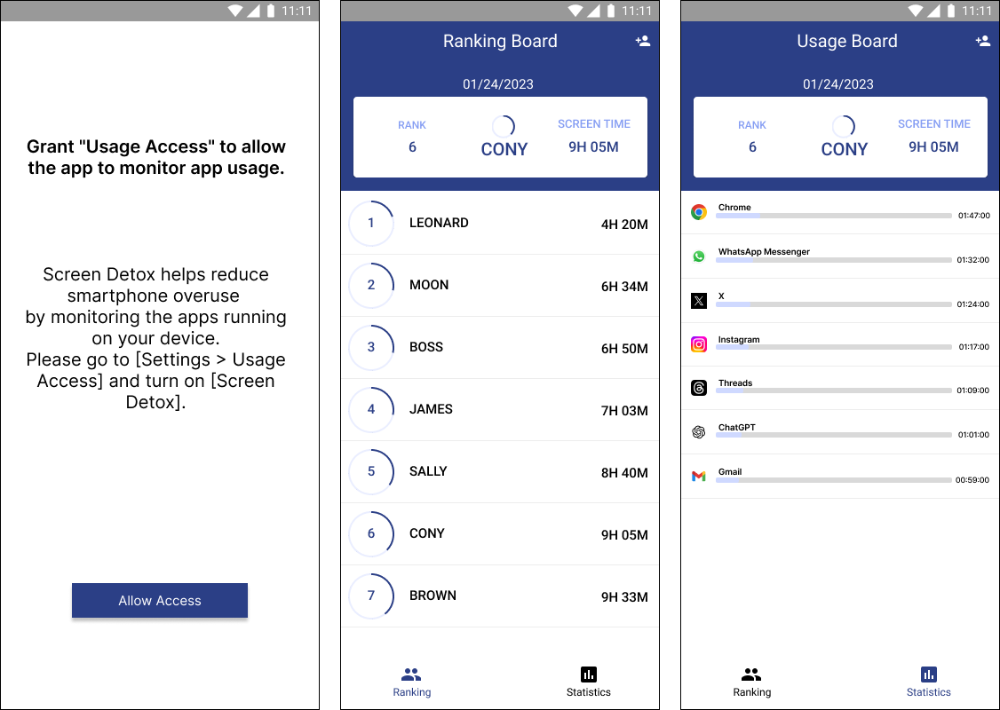

# About

- **Screen Detox**: A smartphone addiction prevention app built to reduce screen time with friends.
- Project Type: Undergraduate Graduation Project  
- Development Period: Oct 2022 – Feb 2023

# Summary

- Screen Detox is an application designed to curb excessive screen time. After experimenting with numerous methods to reduce phone usage, I found that doing so alongside friends was the most effective approach. Screen Detox encourages users to reduce their screen time by comparing their daily usage with friends.
- Following the initial release, the project was systematically upgraded to Version 2.

# Tech Stack

- Language: `Kotlin`
- Backend/Database: `Firebase(Auth, Realtime database)`
- Architecture: `MVVM`
- Asynchronous: `Coroutines`
- Android JetPack: `AAC`(`LiveData` `ViewModel` `Navigation` `DataBinding`)
- Version Control: `Git`
- Design: `Figma`

# Features

- **Smartphone Usage Statistics**

   - Users can track and monitor their smartphone usage statistics (reset daily at 12:00 AM) in the Statistics tab.

- **Friend Screen Time Rankings**
  - Users can view friends' daily screen times and rankings in the Ranking tab.
  - Users can send friend requests by tapping the "Add Friend" button in the Ranking tab. 
  - Users can manage incoming friend requests via the Notification button. Once a request is accepted, they become friends, and their screen times are synchronized and displayed in the rankings.

# What I Learned

* **Version Control**: Learned to systematically manage development workflows using `Git` and adopted a branch-based workflow.

* **Android Architecture**: Studied mobile architecture patterns to reduce boilerplate code and ensure scalability, successfully implementing the `MVVM` pattern using Android Architecture Components (`AAC`).

* **User Authentication & Database**: Managed user data using `Firebase` and integrated Google Sign-In with `Firebase Auth`.

* **Asynchronous Programming**: Studied asynchronous paradigms and leveraged Kotlin `Coroutines` to seamlessly update the UI with data fetched from the `Firebase Realtime Database`.

* **Android Permissions**: Gained a deep understanding of Android permission systems, mastering the implementation of Install-time, Runtime, and Special Permissions.

# Screenshots

